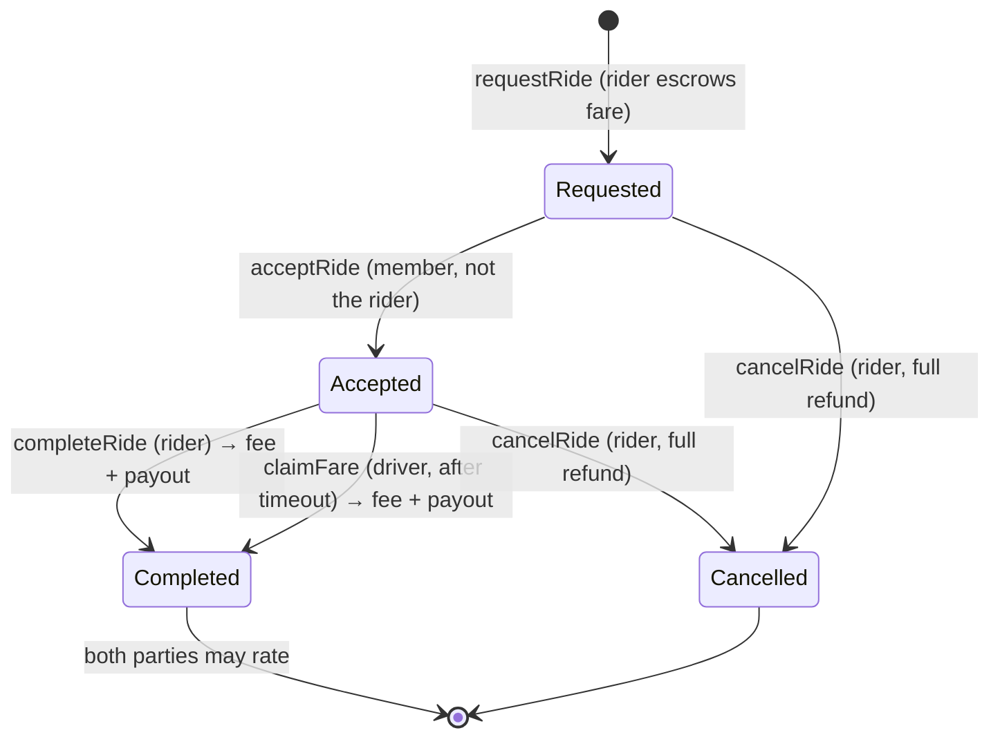

# Project report: Decentralized Ride & Errand Co-op

BITS Pilani (Hyderabad Campus) blockchain course project, Group 5.
Repository: https://github.com/SohanSriData/Blockchain_RideShare (branch `master`).

Each major section ends with **Key points**: short bullets written to be lifted onto slides. Appendix A suggests a slide outline.

---

## Contents

1. Summary
2. Problem and motivation
3. Objectives and scope
4. Requirements and design decisions
5. Technology stack
6. System architecture
7. Smart contracts in detail
8. Ride lifecycle
9. Money flows and the fare split
10. Governance
11. Reputation
12. Indexer (read model)
13. Web application
14. Security analysis
15. Gas and cost analysis
16. Testing and verification
17. Live demo results
18. Bugs found and fixed
19. Evaluation against the spec's parameters
20. Known limits
21. Future work
22. How to run it
23. Repository map
24. Glossary
- Appendix A: suggested slide outline
- Appendix B: contract interface reference

---

## 1. Summary

A driver-owned ride co-op on Ethereum, with no company in the middle. Drivers stake a small refundable deposit to become **members**. **Riders** pay the fare into an on-chain **escrow** when they request a ride. When the ride is completed, the contract splits the fare automatically: a **fee** (5% by default, capped at 20%) goes to a **treasury** owned by the members, and the rest goes to the driver. The fee, pricing and every treasury payment change only through member **proposals** and **votes**. Riders and drivers rate each other from 1 to 5 stars on-chain. There is no owner, admin key, upgrade path or setter anywhere in the system.

The system has three parts:

| Part | What it is | Can it move money? |
|---|---|---|
| Four Solidity contracts | Membership, RideServices, Reputation, Governance | Yes, and only they can |
| Indexer | TypeScript process that rebuilds a SQLite read model from contract events and serves a GET-only HTTP API | No |
| Web app | Next.js app with maps, a browser wallet (MetaMask) and one screen per role | No; it only asks the wallet to sign |

Verification: 81 Foundry tests (98 to 100% line coverage per contract), 21 indexer tests, 7 web unit tests, an end-to-end script that cross-checks the chain and the indexer at every step (including after a chain wipe), Slither static analysis with no high or medium findings, and a full manual demo in Chrome with real MetaMask.

**Key points**
- Ride-hailing without a platform: fares are escrowed and split by code.
- Members (staked drivers) govern the fee, pricing and treasury by vote.
- No admin or owner: the contracts are wired by immutable addresses.
- The indexer and the web app are conveniences; all truth and all money live on-chain.

---

## 2. Problem and motivation

- **Drivers lose 15 to 30% of every fare** to centralized platforms (Uber, Ola) that provide no vehicles, fuel or maintenance.
- **The platform decides alone**: it sets the fee, how rides are prioritised and each driver's standing, and drivers have no recourse when the terms change.
- **Riders outside dense cities are under-served**, because matching is tuned for high-volume urban routes.
- **Changing the operator does not fix trust.** Whoever runs the server still holds the money, sets the fee and can quietly favour one side.

The project's answer is to move the rules that matter (escrow, payout, fee, treasury, voting, reputation) into smart contracts that nobody can change unilaterally, and to keep everything else (maps, search, the database behind the UI) out of the money path.

**Key points**
- Problem: high, unilateral platform fees and an operator that must be trusted with the money.
- Idea: replace the operator with contract rules plus member governance.

---

## 3. Objectives and scope

### Objectives

1. Escrow every fare on-chain from request until completion, claim or cancellation.
2. Split the fare automatically and exactly: governed fee to the treasury, the rest to the driver.
3. Let members, and only members, change the fee, pricing parameters and treasury spending by vote.
4. Keep tamper-resistant two-way reputation for riders and drivers.
5. Provide a usable web app with maps and distance-based fare suggestions, without putting maps in the trust path.
6. Demonstrate correctness, fairness, sybil resistance, latency, integrity, security and gas cost (the spec's evaluation parameters, see section 19).

### In scope

Rides with escrow, cancellation and timeout claims; membership with a refundable stake; governance of five proposal types; two-way reputation; an event-sourced indexer; a web app for riders, drivers and members; a local test chain.

### Out of scope (from the spec)

- Dispute resolution (Chainlink VRF juries are named only as future work).
- Fiat on/off ramps or custody by anyone but the contracts.
- KYC or identity verification (sybil resistance relies on the stake).
- Real-time driver tracking, surge pricing, route optimisation.
- Cancellation fees or penalties.
- Private rider-driver messaging.
- Stake slashing.
- Errand-specific features (the title says "Ride & Errand"; the scope is rides).
- Production deployment and native mobile apps.

The full specification, with 90 numbered user stories, is `.scratch/decentralized-ride-coop/spec.md`.

**Key points**
- Six objectives: escrow, automatic split, member governance, reputation, usable maps UI, measurable evaluation.
- Deliberately out of scope: disputes, fiat, KYC, slashing, production deployment.

---

## 4. Requirements and design decisions

| Topic | Decision |
|---|---|
| Membership | One member, one vote. Stake of 0.01 ETH (a deployment parameter), returned in full on exit. A member cannot exit while they have a ride in progress. |
| Currency | Native ETH (test ETH). No token. |
| Fare | The rider chooses the fare and escrows it. The app suggests route distance x the governed per-km rate, never below the governed minimum fare. The contract only enforces the minimum. |
| Who can request | Any address. Only members can accept. |
| Completion | The rider confirms completion. If the rider never does, the driver may claim the fare after the governed claim timeout (30 minutes on public test networks, 2 minutes on the local chain). The timeout is fixed for each ride when it is accepted. |
| Cancellation | Only the rider, at any time before completion or claim, **before or after a driver accepts**, with a full refund and no fee. A cancellation made before the claim always wins over the claim. |
| Fee | 5% by default, 20% cap, whole percent. The fee rounds down and the driver receives the remainder, so no wei is lost (ADR 0001). |
| Governance | Five proposal types: fee, per-km rate, minimum fare, claim timeout and treasury spend. Quorum is 20% of members at creation, rounded up, at least 1. A proposal passes with quorum and more votes for than against. Only members who joined before the proposal was created may vote. Anyone may execute a passed proposal, once, after voting ends. |
| Reputation | Ratings 1 to 5, stored as sum and count, with the average shown to two decimals. Separate driver and rider profiles. One rating per participant per completed ride. |
| Privacy and cost | Pickup and drop-off coordinates appear only in events, rounded to 3 decimal places (about 110 m), and are never stored in contract storage. |
| Safety rules | A driver cannot accept their own request. Funds move only through the contract rules. |
| No admin | No owner, no setters, no upgrade path. Contracts reference each other through immutable addresses (ADR 0002). |
| Local timings | On the local chain voting lasts 1 minute and the claim timeout is 2 minutes, so the whole flow can be demonstrated live. |

Default parameters (from `contracts/script/Deploy.s.sol`):

| Parameter | Local chain (31337) | Other networks | Governed? |
|---|---|---|---|
| Stake | 0.01 ETH | 0.01 ETH | No (immutable) |
| Fee | 5% | 5% | Yes |
| Fee cap | 20% | 20% | No (immutable) |
| Quorum | 20% | 20% | No (immutable) |
| Voting period | 1 minute | 1 day | No (immutable) |
| Per-km rate | 0.0005 ETH | 0.0005 ETH | Yes |
| Minimum fare | 0.001 ETH | 0.001 ETH | Yes |
| Claim timeout | 2 minutes | 30 minutes | Yes |

Stake, voting period, per-km rate, minimum fare and claim timeout can be overridden through environment variables at deployment.

Decision records:

| ADR | Decision |
|---|---|
| 0001 | The fee rounds down and the driver gets the remainder; default pricing values; governed pricing parameters other than the fee are unbounded |
| 0002 | Immutable wiring with no owner: contract addresses predicted from the deployer's nonce |
| 0003 | Slither static analysis run and triage |
| 0004 | Web wallet connection and transaction handling |

**Key points**
- The rider sets and escrows the fare; the app only suggests it.
- The rider can cancel any time before completion for a full refund; the driver is protected by a claim after the timeout.
- Quorum of 20% plus a simple majority; the fee is capped at 20%.

---

## 5. Technology stack

| Layer | Technology | Version |
|---|---|---|
| Smart contracts | Solidity | 0.8.28 |
| Contract tooling | Foundry (forge, anvil, cast) | 1.9.0 |
| Local chain | Anvil, chain id 31337, 1-second blocks | Foundry 1.9.0 |
| Static analysis | Slither (102 detectors) | via `uvx` |
| Runtime | Node.js | 22.13 or later |
| Indexer | TypeScript, viem, built-in `node:sqlite`, `node:http` | viem 2.57 |
| Web framework | Next.js (App Router), React | Next 16.4.6, React 19.3 |
| Wallet and chain | wagmi, viem, TanStack Query | wagmi 3.7.11, viem 2.57.19 |
| Maps | Leaflet via react-leaflet, OpenStreetMap tiles | react-leaflet 5.0 |
| Routing and search | OpenRouteService (through server routes; optional) | REST API |
| Browser wallet | MetaMask | any recent |
| Testing | Foundry tests, Node test runner (`node --test` via tsx) | — |

**Key points**
- Solidity and Foundry for contracts; TypeScript everywhere else.
- No database server: the indexer uses Node's built-in SQLite.
- Maps from OpenStreetMap; routing from OpenRouteService, with a straight-line fallback.

---

## 6. System architecture

```
                     signed transactions (MetaMask)
   Browser  ─────────────────────────────────────────────►  Ethereum (Anvil locally)
 (Next.js +                                                ┌─────────────────────────┐
  wagmi/viem)                                              │ Membership              │
     │   ▲                                                 │ RideServices  (escrow)  │
     │   │ contract reads (eth_call)                       │ Reputation              │
     │   └─────────────────────────────────────────────────│ Governance   (treasury) │
     │                                                     └───────────┬─────────────┘
     │ HTTP GET (rides, history, ratings, proposals)                   │ events (logs)
     ▼                                                                 ▼
 Indexer HTTP API  ◄──── SQLite read model ◄──── Syncer (polls blocks, decodes logs)

 Next.js server routes ──► OpenRouteService (geocoding, routing)   [never in the money path]
```

### Write path

1. The user clicks an action in the web app.
2. The app simulates the call (`eth_call`) against the chain. If it would revert, the readable reason is shown and the wallet is never opened.
3. Otherwise MetaMask asks the user to sign. The transaction is mined in about 1 second locally.
4. The contract checks every rule, moves funds and emits events.

### Read path

- **Live contract values** (stake, fee, membership, claim time, balances) are read directly from the chain.
- **Lists and history** (open rides, my rides, ratings, proposals, treasury history) come from the indexer, which mirrors events into SQLite and is polled every 2 seconds.

### Trust boundaries

- Only the contracts can hold or move ETH.
- The indexer cannot change state. If it is deleted it can be rebuilt from events, and if it lies the contracts still enforce the rules.
- The web app only prepares transactions; the user's wallet signs them.
- Maps and routing are suggestions only. The contracts escrow exactly the fare the rider sends, whatever the map said.

**Key points**
- Writes go wallet → contract; reads come from the contracts and the indexer.
- Three trust levels: contracts (trusted), indexer and web app (convenience, untrusted), maps (suggestion only).

---

## 7. Smart contracts in detail

Four contracts in `contracts/src`, about 460 lines of Solidity in total. Each holds only the state it needs.

### 7.1 Membership

Holds stakes and the member list.

| State | Meaning |
|---|---|
| `STAKE` (immutable) | Exact amount required to join |
| `RIDE_SERVICES` (immutable) | The only contract allowed to mark rides as started or ended |
| `isMember[address]` | Current membership |
| `joinSeq[address]`, `joinCounter` | Monotonic join sequence used for vote eligibility |
| `activeRides[address]` | Rides in progress per driver; blocks exit |
| `memberCount` | Number of current members, used for quorum |

| Function | Rule |
|---|---|
| `join()` payable | Must send exactly `STAKE` (`WrongStake`); not already a member (`AlreadyMember`) |
| `exit()` | Must be a member (`NotMember`); no ride in progress (`RideInProgress`); refunds the stake |
| `rideStarted` / `rideEnded` | Callable only by RideServices (`OnlyRideServices`) |

Events: `MemberJoined`, `MemberExited`.

### 7.2 RideServices

Holds escrowed fares and runs the ride lifecycle.

| State | Meaning |
|---|---|
| `MEMBERSHIP`, `GOVERNANCE` (immutable) | Wiring |
| `rideCount` | Last ride id |
| `rides[id]` | `rider`, `driver`, `fare` (uint128), `status`, `claimableAt` (uint40), packed into three storage slots |

| Function | Who | Rule |
|---|---|---|
| `requestRide(pickupLat, pickupLng, dropLat, dropLng)` payable | Anyone | Fare > 0 and ≥ minimum fare (`FareBelowMinimum`); coordinates in range (`BadCoordinates`). Coordinates are passed in micro-degrees and emitted rounded to milli-degrees, half away from zero |
| `acceptRide(id)` | Members | Must be a member (`NotMember`); ride must be Requested (`WrongStatus`); not the rider (`SelfDealing`). Records the driver and fixes `claimableAt = now + claimTimeout` |
| `cancelRide(id)` | Rider | Only the rider (`NotRider`); Requested or Accepted (`WrongStatus`); full refund |
| `completeRide(id)` | Rider | Only the rider; must be Accepted; settles the fare |
| `claimFare(id)` | Driver | Must be Accepted; only the driver (`NotDriver`); not before `claimableAt` (`ClaimTooEarly`); settles the fare |
| `getRide(id)` view | Anyone | Returns rider, driver, fare, status and claimable time |

Settlement (`_settle`) computes `fee = fare × feePercent / 100` (rounded down) and `driverAmount = fare − fee`. It marks the ride Completed and emits `FareSplit` and `RideCompleted` before sending the fee to the treasury and the remainder to the driver, all in one transaction. All functions that send ETH are protected by a `nonReentrant` lock.

Events: `RideRequested` (with rounded coordinates), `RideAccepted`, `RideCancelled` (with the driver, so they know not to drive), `RideCompleted` (with a `claimed` flag), `FareSplit`.

### 7.3 Reputation

| Function | Rule |
|---|---|
| `rate(rideId, score)` | Score 1 to 5 (`BadScore`); ride must be Completed (`RideNotCompleted`); caller must be its rider or driver (`NotParticipant`); once per participant per ride (`AlreadyRated`) |
| `driverProfile` / `riderProfile` | Sum and count |
| `driverAverage` / `riderAverage` | Average x100, rounded half-up (437 means 4.37) |

The rider's rating goes to the driver's driver profile; the driver's rating goes to the rider's rider profile. Sum and count are `uint128` each, packed into one slot. Event: `RatingSubmitted`.

### 7.4 Governance

Holds the treasury and all governed parameters.

| State | Meaning |
|---|---|
| `FEE_CAP_PERCENT`, `QUORUM_PERCENT`, `VOTING_PERIOD` (immutable) | Fixed rules |
| `feePercent`, `perKmRate`, `minFare`, `claimTimeout` | Governed parameters |
| `proposals[id]` | Kind, value, recipient, end time, eligibility snapshot, quorum, votes, executed |
| `hasVoted[id][address]` | One vote per member per proposal |

| Function | Rule |
|---|---|
| `propose(kind, value, recipient)` | Members only; a fee above the cap is rejected (`FeeAboveCap`); a spend needs a recipient (`BadRecipient`). Fixes the end time, the eligibility snapshot (`joinCounter`) and the quorum |
| `vote(id, support)` | Before the end time (`VotingClosed`); a current member who joined before the proposal (`NotEligible`); once (`AlreadyVoted`) |
| `execute(id)` | Anyone, after voting ends (`VotingStillOpen`), once (`AlreadyExecuted`), only if passed (`NotPassed`); a spend must fit the treasury (`InsufficientTreasury`) |
| `receive()` | Anyone can donate to the treasury |
| `quorumFor(n)`, `passed(id)`, `treasuryBalance()` | Views |

Events: `ProposalCreated`, `VoteCast`, `ProposalExecuted`, `ParameterChanged`, `TreasuryDeposit`, `TreasurySpend`.

### 7.5 Wiring without an owner (ADR 0002)

Membership must know RideServices, which is deployed after it. Instead of a setter (which would need an owner), the deployer predicts RideServices' address from its own nonce (`computeCreateAddress(deployer, nonce + 2)`) and passes it to Membership's constructor. Every cross-contract reference is therefore `immutable`, and no function in the system can rewire, pause or upgrade anything. The same `Deployer` contract is used by the deploy script and by the tests, so the tests run against exactly what gets deployed.

**Key points**
- Four small contracts with one job each: stakes, escrow, ratings, treasury and rules.
- Every rule is enforced with a named custom error, which the web app turns into a readable sentence.
- No owner and no setters; addresses are predicted at deployment and immutable.

---

## 8. Ride lifecycle



| From | Action | Who | To | Money |
|---|---|---|---|---|
| — | `requestRide` | Anyone | Requested | Fare moves from rider into escrow |
| Requested | `acceptRide` | A member who is not the rider | Accepted | — (claim time fixed now) |
| Requested or Accepted | `cancelRide` | Rider | Cancelled | Full fare back to the rider |
| Accepted | `completeRide` | Rider | Completed | Fee to treasury, rest to driver |
| Accepted (after timeout) | `claimFare` | Driver | Completed | Fee to treasury, rest to driver |

Properties proven by tests:
- A ride can be completed or cancelled only once; funds are never paid twice.
- Only one driver can accept a ride.
- A rider's cancellation before the claim always wins.
- A later governance vote cannot change the claim timeout of a ride already accepted.
- A member with a ride in progress cannot withdraw their stake.

**Key points**
- Four states: Requested, Accepted, Completed, Cancelled.
- Escrow protects the driver (the money exists before they drive) and the rider (full refund until completion).
- The claim timeout stops a rider from never confirming.

---

## 9. Money flows and the fare split

```
 Rider ──fare──► RideServices (escrow)
                   ├── on completion/claim ──► fee (feePercent, rounded down) ──► Governance treasury
                   │                        └─► fare − fee ──────────────────────► Driver
                   └── on cancellation ──────► full fare ───────────────────────► Rider

 Driver ──stake 0.01 ETH──► Membership ──(on exit, no ride in progress)──► Driver
 Anyone ──donation──► Governance treasury ──(passed Spend proposal)──► recipient
```

Worked examples (real numbers from the live demo, section 17):

| Ride | Fare | Fee % | Fee to treasury | Driver receives |
|---|---|---|---|---|
| #1 | 0.005893 ETH | 5% | 0.00029465 ETH | 0.00559835 ETH |
| #3 (after the vote) | 0.005424 ETH | 8% | 0.00043392 ETH | 0.00499008 ETH |

Rounding: the fee is `fare × feePercent / 100` in integer wei, rounded down, and the driver receives `fare − fee`. So `fee + driverAmount = fare` exactly, for every fare. A fuzz test checks this conservation property over random fares and fee percentages.

Suggested fare (off-chain, in the web app): `max(route distance × perKmRate, minFare)`, with the distance rounded up to the nearest metre. For ride #1 the road route was 11.786 km (shown as 11.8 km), so 11.786 × 0.0005 ETH = 0.005893 ETH. The rider can edit the suggestion; the contract enforces only the minimum fare.

**Key points**
- Every wei is accounted for: fee + driver payout = fare, always.
- The fee goes straight to the member-owned treasury in the same transaction.
- The stake is a deposit, not a fee: returned in full on exit.

---

## 10. Governance

### Lifecycle

1. **Propose.** A member creates a proposal of one of five kinds: Fee (percent, at most 20), PerKmRate (wei per km), MinFare (wei), ClaimTimeout (seconds), Spend (amount and recipient). At creation the contract fixes the end time (now + voting period), the quorum and the eligibility snapshot.
2. **Vote.** Each eligible member votes once, for or against, before the end time.
3. **Tally.** A proposal passes if `for + against ≥ quorum` and `for > against`.
4. **Execute.** After the end time anyone can execute a passed proposal once. Parameter changes take effect immediately; a spend sends treasury ETH to the recipient.

### Rules that keep it fair

- **One member, one vote**, and each member has paid the same stake.
- **Quorum fixed at creation**: `ceil(20% × members)`, at least 1. Joins or exits during voting cannot move the goalposts.
- **Eligibility by join sequence**: only members who joined before the proposal may vote, so nobody can join mid-vote to swing it. A counter is used instead of block numbers, because several joins and proposals can land in the same block.
- **Fee cap** of 20%, enforced when the proposal is created.
- **Executed once**, by anyone: no admin is needed to apply a decision.
- **Rides in progress keep their terms**: the claim timeout is fixed at acceptance. The fee is read at settlement, so a fee change applies to every ride completed afterwards.

### Quorum examples

| Members | Quorum (20%, rounded up, minimum 1) |
|---|---|
| 1 to 5 | 1 |
| 6 to 10 | 2 |
| 11 to 15 | 3 |
| 50 | 10 |

**Key points**
- Five things can be governed: fee, per-km rate, minimum fare, claim timeout, treasury spending.
- Quorum and voter eligibility are fixed when the proposal is created.
- Anyone can execute a passed proposal; there is no admin.

---

## 11. Reputation

- After a ride is **Completed**, the rider rates the driver and the driver rates the rider, 1 to 5, once each.
- Drivers and riders have **separate profiles**, so being a good rider does not inflate your driver score.
- Ratings on cancelled or unfinished rides, by outsiders, or twice are rejected on-chain.
- The contract stores only sum and count; the average is computed on read (x100, rounded half-up). The web app shows it as "★ 4.50 (2)".
- Because every rating needs a completed, paid ride, fake ratings cost the full fare plus the fee each time.

**Key points**
- Two-way, per-role, one rating per completed ride.
- Tamper-resistant: stored on-chain and tied to a real paid ride.

---

## 12. Indexer (read model)

Blockchains are slow to query for lists ("all open rides near me", "my history"). The indexer mirrors contract events into SQLite so the web app can read them quickly. It can never change on-chain state.

### Components (`indexer/src`)

| File | Role |
|---|---|
| `events.ts` | Contract ABIs and event decoding |
| `sync.ts` | `Syncer`: polls the chain (every second by default), fetches logs block range by block range, applies them in (block, log index) order |
| `model.ts` | `ReadModel`: SQLite tables and queries |
| `server.ts` | GET-only HTTP API with CORS |
| `index.ts` | Wiring and configuration (`RPC_URL`, `DEPLOYMENT`, `INDEXER_DB`, `INDEXER_PORT`, `POLL_MS`) |

### Robustness

- **Idempotent replays**: every event is applied with a (block, log index) cursor, so processing the same log twice changes nothing.
- **Reorg and wipe detection**: the syncer stores the last block hash. If it no longer matches (a restarted local chain or a reorganisation), the model resets and replays from the start.
- **Chain time, not wall clock**: a proposal's open or closed status uses the latest block timestamp, so it stays correct when Anvil's clock runs ahead.
- **Disposable**: delete the database and it rebuilds from events.

### Tables

`members`, `rides` (rider, driver, fare, status, claimed flag, fee, driver amount, rounded coordinates), `ratings`, `proposals` (kind, value, recipient, end time, quorum, votes, executed), `treasury` (deposits and spends), `params` (parameter changes), `meta` (cursor and last block hash).

### HTTP API (port 8787)

| Endpoint | Returns |
|---|---|
| `GET /health` | `{ ok, lastBlock }` |
| `GET /rides/open` | Rides waiting for a driver |
| `GET /rides/:id` | One ride with its split |
| `GET /history/:address` | Rides where the address is rider or driver |
| `GET /reputation/:address` | Driver and rider profiles (count, sum, average x100) |
| `GET /proposals` | Proposals with status: open, passed, failed or executed |
| `GET /treasury` | Balance and deposit/spend history |
| `GET /members` | Current members |

**Key points**
- Event-sourced: the read model is derived only from on-chain events.
- Survives restarts, reorgs and chain wipes by replaying.
- Read-only and disposable: not part of the trust path.

---

## 13. Web application

Next.js 16 (App Router), wagmi 3, viem and react-leaflet. Each role has its own screen and accent colour, so side-by-side demo windows are easy to tell apart.

### Screens

| Screen | Route | Colour | Contents |
|---|---|---|---|
| Home | `/` | — | Introduction and three entry cards: "I need a ride", "I drive", "Governance" |
| Ride | `/rider` | Teal | Booking screen: map beside a "Book a ride" panel (pickup and drop-off rows, address search, distance, rate, minimum fare, editable fare offer, Request ride). A "Current ride" card with a step tracker and the next action (cancel, confirm completion, rate the driver). Past rides below |
| Drive | `/driver` | Amber | Dashboard: stat cards (total earned and completed rides, driver rating, membership with Join/Leave). "Active ride" cards with the tracker and a claim countdown. Open jobs, nearest first, beside the map. Past rides with the amount received and a rider rating control |
| Governance | `/governance` | Indigo | Current rules and the treasury side by side (ride fees and donations), new proposal form, proposals with vote and execute buttons |

### Shared elements

- **Header**: sticky, highlights the current screen, and shows who is acting: a role badge, ETH balance, membership and rating next to the wallet address.
- **Ride tracker**: Requested → Accepted → Completed (or a red Cancelled), with a hint such as "A driver is on the way. Confirm completion once you have arrived to release the fare."
- **Maps**: OpenStreetMap tiles through Leaflet. The rider clicks the map or searches an address; the driver sees open pickups as markers sorted by distance from "my location".
- **Routing**: Next.js server routes call OpenRouteService for geocoding and road distance, so the API key never reaches the browser. If routing fails, the app falls back to straight-line (haversine) distance.

### Transaction handling (ADR 0004)

- **Pinned chain**: every read and write uses the deployment's chain id. If the wallet is on another network, the header shows "Switch to local chain".
- **Simulate first**: each action is simulated before MetaMask opens. A call that would fail (for example "The claim timeout has not elapsed yet.") shows its readable reason, and nothing is sent or paid.
- **Clear states**: Checking… → Confirm in wallet… → Pending… → Confirmed, or a readable error. Contract errors are mapped to sentences such as "You cannot accept a ride you requested yourself."
- **Stable connection**: one click connects. The wallet state is kept in a cookie and passed to the server render, so returning users never see a "Connect wallet" flash. Status resets when the account changes.

**Key points**
- One screen per role: a booking screen for riders, a dashboard for drivers.
- A live ride tracker and a header that always shows who is acting.
- Failing actions are caught before the wallet opens: readable errors, no wasted gas.

---

## 14. Security analysis

| Threat | Mitigation |
|---|---|
| Reentrancy while paying out | `nonReentrant` lock on every function that sends ETH; state updated before transfers (checks-effects-interactions). A test uses a malicious driver contract that tries to re-enter; it cannot drain the escrow |
| Double payout or double refund | Status checks: completion, claim and cancellation each require a specific status and move the ride to a final state first |
| Someone else completing or cancelling my ride | Only the rider can complete or cancel (`NotRider`); only the driver can claim (`NotDriver`) |
| Driver accepting their own request to farm fees | `SelfDealing` check. Using a second address is still possible; it costs the fee and minimum fare each time (see section 20) |
| Rider never confirming | The driver claims after the timeout fixed at acceptance |
| Driver claiming for a ride that never happened | The rider can cancel at any time before the claim; a cancel before the claim wins |
| Fake members swinging votes (sybil attack) | Each member costs the full stake. Joining after a proposal does not grant a vote on it |
| Changing the rules mid-vote | Quorum and eligibility are fixed at proposal creation |
| Excessive fee | Fee capped at 20% in the contract |
| Admin key compromise | There is none: no owner, no setters, no upgrade path |
| Fake ratings | One rating per participant per completed (paid) ride |
| Lost wei through rounding | The fee rounds down and the driver gets the remainder; conservation is fuzz-tested |
| Exposing precise locations | Coordinates rounded to about 110 m and only emitted in events, never stored |
| Leaking the routing API key | Used only by server routes; checked absent from the browser bundle and the git history |

**Static analysis.** Slither (102 detectors) reported 19 results across 7 detector types, none of high or medium impact. Each was reviewed: the ETH transfers go only to the ride's own rider or driver or to a voted recipient, use of `block.timestamp` is intended for timeouts and voting windows, and the rest are style or false positives. Full triage: `docs/adr/0003-slither-static-analysis-triage.md`. This is not a professional audit.

**Key points**
- Reentrancy guard plus checks-effects-interactions; tested with an attacker contract.
- Every money path has an access rule and a status rule.
- No admin key to steal; Slither found nothing high or medium.

---

## 15. Gas and cost analysis

### Design comparison: events versus storage

Ride details (coordinates and so on) are emitted in events rather than kept in contract storage. A baseline contract that stores everything was measured against this design in `GasComparison.t.sol`:

| Operation | This design (gas) | Full-storage baseline (gas) | Difference |
|---|---|---|---|
| `requestRide` | 113,075 | 233,164 | −51% |
| `acceptRide` | 87,148 | 71,206 | +22% |
| `completeRide` | 90,479 | 40,607 | +123% |
| **Request + accept + complete** | **290,702** | **344,977** | **−16%** |

Accept and complete cost more here because they do work the baseline skips: they update the driver's active-ride counter, fix the claim time, read the governed fee and pay out the split. The full ride still costs 16% less.

### Gas per function (Foundry gas report, median)

| Contract | Function | Median gas |
|---|---|---|
| Membership | `join` | 77,425 |
| Membership | `exit` | 42,193 |
| RideServices | `requestRide` | 101,333 |
| RideServices | `acceptRide` | 86,675 |
| RideServices | `completeRide` | 90,006 |
| RideServices | `claimFare` | 48,118 |
| RideServices | `cancelRide` | 62,814 |
| Reputation | `rate` | 63,327 |
| Governance | `propose` | 149,705 |
| Governance | `vote` | 83,085 |
| Governance | `execute` | 64,791 |

Medians come from all test calls, so some include failing paths. The design comparison table above measures the happy path directly.

### What a ride costs in fees

At an illustrative gas price of 10 gwei, a full ride (request, accept, complete) uses 290,702 gas, about 0.0029 ETH in transaction fees split across rider and driver. On a layer-2 network the same transactions would cost a small fraction of that; see section 21.

**Key points**
- Coordinates in events instead of storage: a full ride costs 16% less, and requesting costs 51% less.
- A full ride uses about 291k gas; the most expensive single action is creating a proposal (about 150k).

---

## 16. Testing and verification

### Strategy

Tests sit at two seams only:
1. **The public interface of the deployed four-contract suite**, using only public calls and events. Tests deploy through the same `Deployer` as production.
2. **The indexer read model against emitted events.**

Expected values come from literals or the spec, never from re-running the code's own formula. Work was done test-first in vertical slices.

### Results

| Check | Result |
|---|---|
| Foundry tests (`forge test`) | **81 passing** in 6 suites: RideServices 28, Governance 25, Reputation 11, Membership 9, FailurePaths 7, GasComparison 1 |
| Line coverage per contract | RideServices 100%, Reputation 100%, Membership 100%, Governance 98.5% |
| Branch coverage per contract | RideServices 100%, Reputation 100%, Governance 95.8%, Membership 85.7% |
| Fuzz test | Conservation of funds: fee + driver payout = fare for random fares and fee percentages |
| Reentrancy test | Malicious driver contract cannot drain the escrow |
| Indexer tests | **21 passing** (14 read-model, 7 sync including reorg and wipe recovery) |
| Web unit tests | **7 passing** (geometry and fare helpers) |
| Typecheck, lint, `next build` | Clean |
| End-to-end (`npm run e2e`) | Passes. See below |
| Static analysis (Slither) | No high or medium findings (ADR 0003) |
| Secret hygiene | Routing API key absent from the browser bundle and from git history |
| Manual browser demo | Full demo script in Chrome with real MetaMask, see section 17 |

Examples of RideServices tests: fare escrowed and coordinates rounded; below-minimum or zero fare rejected; non-member cannot accept; driver cannot accept own request; only one driver can accept; 5% split exact; fee rounds down with no loss; completion uses the currently governed fee; claim blocked before the timeout and allowed after; timeout fixed at acceptance; rider cancel beats the claim; no double cancel or completion; member cannot exit with a ride in progress; reentrant driver cannot drain the escrow.

### End-to-end script (`scripts/e2e.mts`)

Starts a real Anvil chain, deploys, runs the indexer model and its HTTP API, then performs join, request, accept, complete, rate, propose, vote and execute. **After every step it compares on-chain state with the indexer** (membership, ride status, rating sums, treasury balance, open rides through the API, proposal votes). It checks the 95% payout (0.0095 ETH of a 0.01 ETH fare) and the 5% fee exactly, and that the fee became 8% by vote. It then **wipes and restarts the chain** with the same indexer database and checks that the indexer detects the wipe and stays consistent. It ends with "E2E passed".

**Key points**
- 109 automated tests in total (81 contract, 21 indexer, 7 web).
- 100% line coverage on three contracts, 98.5% on Governance.
- An end-to-end run proves the chain and the indexer agree at every step, even after a chain wipe.

---

## 17. Live demo results

The full demo script in `docs/DEMO.md` was run on the local chain in Chrome with real MetaMask, using the Rider, Driver and Member 3 test accounts. Balances were checked on-chain with `cast` after each money step.

| Step | What happened | Verified result |
|---|---|---|
| Join | Driver and Member 3 each joined with 0.01 ETH | Both shown as staked members |
| Request | Rider picked pickup and drop-off on the map: 11.8 km by road | Suggested fare 0.005893 ETH, escrowed as ride #1 |
| Accept | Driver accepted ride #1 | Status Accepted, claim time fixed |
| Self-accept | Member 3 requested a ride and tried to accept it | Reverted with `SelfDealing()` |
| Complete | Rider confirmed completion | Driver +0.00559835 ETH (95%), treasury +0.00029465 ETH (5%), exact to the wei |
| Rate | Rider rated the driver 5, driver rated the rider 5 | Badges showed ★ 5.00 (1) |
| Govern | Driver proposed fee 5% → 8%, voted for; executed after the 1-minute window | Fee 8% on-chain (quorum 1 with 2 members) |
| New split | Ride #3 at 0.005424 ETH completed | Driver 0.00499008 ETH (92%), treasury 0.00043392 ETH (8%) |
| Cancel | Ride #4 cancelled before acceptance | Full 0.005424 ETH refunded (rider paid only gas) |
| Early claim | Driver clicked Claim fare before the timeout | "The claim timeout has not elapsed yet.", nothing sent |
| Claim | Driver claimed ride #5 after the 2-minute timeout | 92/8 split paid |
| Navigation | Every order of Home, Ride, Drive and Governance | No console errors, one map per map page |

Treasury after these rides: 0.00116249 ETH, exactly the sum of the three fees. The Drive dashboard's "Earned" figure matched the sum of the driver's payouts on-chain.

For a demo on one laptop, run one Chrome profile per role (each with its own MetaMask) side by side; see `docs/DEMO.md` section 2.3.1.

**Key points**
- Every money step was checked on-chain and matched to the wei.
- A live governance vote changed the fee from 5% to 8%, and the next rides used the new split.

---

## 18. Bugs found and fixed

Found by the automated checks:

- A cached chain head in the indexer's client delayed events by up to 4 seconds. Fixed by reading the block number without the cache.
- Proposal status based on the wall clock was wrong when Anvil's clock ran ahead. Replaced with chain time.
- Two fee tests recomputed the contract's own formula, which would hide a formula bug. They now use literal expected values.
- The routing API key appeared to be ignored because of a cached environment load. Fixed with a forced reload.

Found in the browser demo with real MetaMask:

- Navigating from Driver to Rider crashed the map ("Cannot read properties of undefined (reading 'appendChild')"). Next.js Cache Components kept the old page mounted while Leaflet removed its map. Cache Components is now off.
- "Connect wallet" reopened MetaMask's account picker on every click and collided with a still-open prompt. The connector no longer forces the picker.
- Reads followed the wallet's network, so with the wallet elsewhere the stake could not be read and Join stayed disabled. All calls are now pinned to the deployment's chain.
- An early "Claim fare" was broadcast and reverted, costing gas, and the page showed "Pending…" for a long time before a bare "Failed on chain". Every action is now simulated first, and on-chain reverts report their reason at once.
- A button's "Confirmed" status leaked to the button that replaced it (Join to Leave) and across account switches. Fixed with distinct component keys and a reset on account change.
- "Connect wallet" flashed on every page load before the automatic reconnect. Wallet state is now cookie-backed and passed to the server render.

**Key points**
- Automated tests caught indexer timing, clock and test-design bugs.
- A real-wallet demo caught six browser and wallet bugs that tests could not; all are fixed.

---

## 19. Evaluation against the spec's parameters

| Parameter | How it was demonstrated | Result |
|---|---|---|
| Functional correctness | 81 contract tests covering every rule and error; e2e script; live demo | Met |
| Fairness and decentralisation | One member one vote; quorum and eligibility fixed at creation; no admin; anyone can execute | Met for 6 or more members. With 5 or fewer, the quorum is 1 vote, so a single member can pass an unopposed proposal (seen in the demo with 2 members) |
| Sybil resistance | Each extra identity costs the full stake; joining after a proposal gives no vote on it | Met within the stake's deterrence |
| Latency | Every write settles in one transaction (about 1 s locally, about 12 s on Sepolia); reads lag by one indexer poll (1 s) plus the UI poll (2 s) | Met |
| End-to-end integrity | e2e cross-checks the chain and the indexer after every step and after a chain wipe | Met |
| Security | Slither: no high or medium findings; reentrancy attack test; access and status checks on every money path | Met (not an audit) |
| Gas cost | Events-only design saves 16% on a full ride and 51% on a request against a full-storage baseline | Met |

**Key points**
- All seven evaluation parameters are demonstrated.
- One honest caveat: small co-ops (5 or fewer members) need only one vote to pass an unopposed proposal.

---

## 20. Known limits

- **Small-co-op quorum.** Quorum is 20% rounded up, so with 5 or fewer members one vote passes an unopposed proposal. A minimum quorum of 2 (or a higher percentage) would fix this; it was not part of the spec.
- **Two-address farming.** A driver can request from a second address and accept from the first. Each attempt costs the fee and the minimum fare.
- **No dispute resolution or slashing.** A rider who cancels after the driver arrived pays nothing; a driver who never shows up loses nothing.
- **Unbounded pricing parameters.** Apart from the fee, governed parameters have no bounds, as the spec says (for example a minimum fare of 0 or an instant claim timeout). Members own this risk (ADR 0001).
- **Fee changes apply to rides in progress.** The fee is read at settlement, so a vote that passes while a ride is accepted applies to that ride; the claim timeout, by contrast, is fixed at acceptance.
- **Coordinates are public** (rounded to about 110 m) because they are emitted in events.
- **No Sepolia deployment.** The steps are in `docs/DEMO.md`; the web app still needs the Sepolia chain configured.
- **Duplicated rules.** The proposal-kind list exists in three places, and the pass rule and rating average are duplicated between the contracts and the indexer.
- **Switching roles in MetaMask** requires each account to be connected to the site first.
- Not audited. Do not use with real funds.

---

## 21. Future work

- **Disputes**: a juror pool selected with Chainlink VRF, plus stake slashing for proven misbehaviour.
- **Fairer small-co-op governance**: a minimum quorum of 2, or quorum by stake-weighted participation.
- **Cancellation fee after acceptance**, paid to the driver, as a governed parameter.
- **Layer-2 deployment** (for example Optimism, Base or Arbitrum) to cut fees far below the mainnet estimate in section 15.
- **Public testnet deployment** on Sepolia, with the web app's chain made configurable.
- **Errands**: a second job type with item descriptions and proof of delivery.
- **Private location exchange** between matched rider and driver (encrypted or off-chain).
- **Live driver tracking and push notifications.**
- **Professional audit** before any real funds.

---

## 22. How to run it

Prerequisites: Node.js 22, Foundry 1.9.0, Git, MetaMask. On Windows use PowerShell for npm and Git Bash for Foundry.

```sh
git clone --recurse-submodules https://github.com/SohanSriData/Blockchain_RideShare.git
cd Blockchain_RideShare
npm ci
cp .env.example .env.local      # optional: add ORS_API_KEY for road routes
npm run chain                   # terminal 1: local chain on :8545
npm run deploy:local            # terminal 2: deploy and sync addresses to the web app
npm run dev:indexer             # terminal 3: read API on :8787
npm run dev:web                 # terminal 4: app on http://localhost:3000
```

In MetaMask add the network (RPC `http://127.0.0.1:8545`, chain id 31337) and import the public Anvil test accounts. Checks: `npm test` (contracts, indexer, web), `npm run typecheck`, `npm run e2e`. The demo script, accounts and troubleshooting are in `docs/DEMO.md`.

---

## 23. Repository map

| Path | Contents |
|---|---|
| `contracts/src/` | Membership, RideServices, Reputation, Governance |
| `contracts/test/` | Foundry tests: RideServices, Governance, Reputation, Membership, FailurePaths, GasComparison, shared Fixture |
| `contracts/script/` | `Deploy.s.sol` and the shared `Deployer` |
| `indexer/src/` | Event decoding, syncer, SQLite read model, HTTP API, tests |
| `web/src/app/` | Pages: home, rider, driver, governance; server routes for geocoding and routing |
| `web/src/components/` | Header, ride tracker, transaction button, map, rating, reputation badge |
| `web/src/lib/` | Contract ABIs and addresses, wagmi config, indexer client, geometry, error messages |
| `scripts/` | `check-env.mjs`, `e2e.mts`, `sync-deployment.mjs` |
| `docs/` | This report, `DEMO.md`, `COLLABORATING.md`, ADRs 0001 to 0004 |
| `CONTEXT.md` | Domain glossary |
| `.scratch/` | Spec (90 user stories) and local tickets |

---

## 24. Glossary

| Term | Meaning |
|---|---|
| Co-op | The driver-owned system of four contracts; no owner or admin |
| Member | An address that has staked and joined. Only members accept rides, propose and vote |
| Stake | Fixed refundable deposit to join (0.01 ETH by default) |
| Rider / Driver | The requester and the accepting member of one ride |
| Escrow | The fare held by RideServices from request until completion, claim or cancellation |
| Fare | The amount the rider offers; at least the governed minimum |
| Fee | Governed percentage of the fare paid to the treasury on completion (5% default, 20% cap) |
| Treasury | ETH held by Governance, from fees and donations; spent only by a passed proposal |
| Proposal | A member-created change to the fee, per-km rate, minimum fare, claim timeout, or a treasury spend |
| Quorum | Minimum number of votes for a proposal to count: 20% of members at creation, rounded up, at least 1 |
| Claim timeout | Delay after acceptance after which the driver may claim an unconfirmed fare |
| Indexer | Read-only process that rebuilds a SQLite read model from events |
| Anvil | Foundry's local test blockchain |
| Gas | The unit of computation cost on Ethereum |

---

## Appendix A: suggested slide outline

| # | Slide | Source sections |
|---|---|---|
| 1 | Title: Decentralized Ride & Errand Co-op, Group 5 | — |
| 2 | The problem with ride-hailing platforms | 2 |
| 3 | Our idea: a driver-owned co-op run by smart contracts | 1 |
| 4 | Objectives and scope | 3 |
| 5 | Key design decisions | 4 |
| 6 | Technology stack | 5 |
| 7 | Architecture: write path, read path, trust boundaries | 6 |
| 8 | The four contracts | 7 |
| 9 | Ride lifecycle (state diagram) | 8 |
| 10 | Money flows and the fare split, with real numbers | 9 |
| 11 | Governance: propose, vote, execute; fairness rules | 10 |
| 12 | Reputation | 11 |
| 13 | Indexer: event sourcing and recovery | 12 |
| 14 | Web app: Ride screen and Drive dashboard (screenshots) | 13 |
| 15 | Security: threats and mitigations; Slither | 14 |
| 16 | Gas: events versus storage | 15 |
| 17 | Testing: 109 tests, coverage, e2e | 16 |
| 18 | Live demo results | 17 |
| 19 | Bugs found by a real-wallet demo | 18 |
| 20 | Evaluation against the spec | 19 |
| 21 | Limits and future work | 20, 21 |
| 22 | Thank you / questions | — |

Screenshots worth capturing for slides 14 and 18: the Ride screen with a route and the tracker at "Accepted", the Drive dashboard with an active ride and an open job, and the Governance screen with an executed fee proposal.

---

## Appendix B: contract interface reference

```solidity
// Membership
function join() external payable;
function exit() external;
function isMember(address) external view returns (bool);
function memberCount() external view returns (uint256);
function STAKE() external view returns (uint256);

// RideServices
function requestRide(int256 pickupLat, int256 pickupLng, int256 dropLat, int256 dropLng) external payable returns (uint256 id);
function acceptRide(uint256 id) external;
function cancelRide(uint256 id) external;
function completeRide(uint256 id) external;
function claimFare(uint256 id) external;
function getRide(uint256 id) external view returns (address rider, address driver, uint256 fare, uint8 status, uint256 claimableAt);

// Reputation
function rate(uint256 rideId, uint8 score) external;
function driverAverage(address) external view returns (bool hasRating, uint256 averageX100);
function riderAverage(address) external view returns (bool hasRating, uint256 averageX100);

// Governance
function propose(uint8 kind, uint256 value, address recipient) external returns (uint256 id); // kind: 0 Fee, 1 PerKmRate, 2 MinFare, 3 ClaimTimeout, 4 Spend
function vote(uint256 id, bool support) external;
function execute(uint256 id) external;
function feePercent() external view returns (uint256);
function perKmRate() external view returns (uint256);
function minFare() external view returns (uint256);
function claimTimeout() external view returns (uint256);
function treasuryBalance() external view returns (uint256);
receive() external payable; // donations
```
